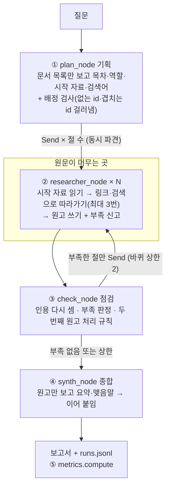

# REPORT — 딥리서처 에이전트: 외국 제출 서류 인증 리서치

<!-- SUMMARY -->

---

## 1. 주제와 코퍼스

### 무엇을, 왜

주제는 **외국에 제출하는 서류의 인증**이다. 아포스티유(협약국끼리 쓰는 간이 인증), 영사확인(비협약국 대사관 인증), 공증, 번역 인증, 그리고 나라마다 다른 신분·가족·학력·범죄경력·법인 서류를 다룬다. 이 주제를 고른 이유는 과제 조건 네 가지에 그대로 맞기 때문이다.

| 조건 | 이 주제에서 |
|---|---|
| 한 질문에 여러 자료 | "출생증명서를 외국에 내려면?"에는 서류·공증·협약·번역 문서가 모두 필요하다 |
| 자료 전체가 창에 안 들어감 | 아래 숫자 참조(창의 1.15배) |
| 자료끼리 서로 가리킴 | 협약↔공증↔서류↔나라 문서가 위키백과 링크로 얽혀 있다(문서 안 링크 7,884개) |
| 산출물이 장문 | 절차 비교·나라별 정리는 절 여러 개짜리 보고서가 된다 |

### 몇 건, 얼마나 큰가

| 항목 | 값 |
|---|---|
| 문서 수 | **324건**(시드 66 + 링크 1단계 229 + 2단계 29) |
| 총 글자 수 | **6,086,463자** |
| 총 토큰 | **1,211,686 토큰**(tiktoken o200k_base) |
| 사용 모델 창 | gpt-5.6-luna 1,050,000 토큰(최대 입력 922,000). 2026-11-09 OpenAI 모델 문서 확인 |
| 창 대비 | **1.15배 → 한 컨텍스트에 다 넣을 수 없다** |
| 코퍼스 안 링크 | 7,884개(문서당 나가는 링크 중앙값 19) |
| 들어오는 링크 0개 문서 | 2건(d052 Medical certificate, d053 Certificate of origin) — 배정이 유일한 경로 |
| 핵심/주변 | 핵심 170건(578,757 토큰), 주변 154건 |

출처는 영어 위키백과(CC BY-SA 4.0)다. 한국어 위키백과는 이 주제 문서가 거의 없어 영어판을 썼다("아포스티유"는 넘겨주기 문서뿐이다). 질문과 보고서는 한국어로 쓰고, 근거는 영어 원문 문구를 그대로 따온다.

### 수집하며 고친 것(정직하게)

수집은 [scripts/collect_wiki.py](scripts/collect_wiki.py)가 한다. 시드에서 링크를 따라 넓히고, 첫 문단으로 주제를 거르며, 총 토큰이 목표를 넘을 때까지 받는다. 처음 짠 규칙대로는 결과가 나빠 네 번 고쳤다.

1. **주제와 먼 문서가 섞였다.** 1차 확장에서 Oregon, Cicero, Argentina 같은 문서가 들어왔다. 첫 문단 거르기 규칙을 넣었다. "~는 나라/주/섬이다"나 인물 생몰년으로 시작하면 빼고, 핵심 낱말이 있어야 남긴다.
2. **창을 잘못 잡았다.** 처음엔 40만 토큰 창을 가정해 48만 토큰(148건)에서 멈췄다. 모델 문서를 확인하니 창이 105만 토큰이었다. 업무와 가까운 시드(나라별 여권·신분증, 혼인·원산지 서류, 비엔나 영사협약 등)를 더해 다시 넓혔다.
3. **같은 꼴 문서가 몰렸다.** "Yemeni passport, Polish passport…", "Visa policy of ○○"가 링크로 줄줄이 딸려 왔다. 제목 끝 낱말이나 앞부분이 같은 문서는 8건까지만 받게 했다(654건을 이 규칙으로 걸렀다).
4. **시드가 엉뚱한 문서였다.** 시드 "Jurat"은 공증 선서 문구가 아니라 영국 채널 제도의 판사(jurat) 문서였다. 제목만 보고 고르면 틀린다는 사례로 코퍼스에 그대로 두었다. 이 문서로 답할 생각이던 질문은 일본 호적(Koseki) 질문으로 바꿨다.

**한계:** 핵심 문서만으로는 57.9만 토큰이라 창을 넘지 못한다. 창을 넘기는 데에는 번역 이론·외교 일반·출입국 같은 주변 문서 154건이 기여한다. 이 주제의 위키백과 문서는 그만큼이 전부다. 대신 주변 문서는 "배정이 엉뚱한 자료로 새는가"를 보는 방해물 역할을 한다. 지표 `core_read_ratio`(읽은 글자 가운데 핵심 문서 비율)가 이를 잰다.

### 질문 세트 (10건, [data/questions.json](data/questions.json))

정답표는 없다. 질문마다 성격과 "왜 나눌 만한가" 한 줄만 둔다.

| id | 성격 | 질문(줄임) | 왜 나눌 만한가 |
|---|---|---|---|
| q1 | 한 건 | 아포스티유 협약 채택 시점과 증명서 항목 | 나눌 만하지 않다 — 협약 문서 한 건 |
| q2 | 한 건 | 일본 호적(koseki)의 기록 내용·단위·변화 | 나눌 만하지 않다 — Koseki 문서 한 건 |
| q3 | 흩어짐 | 공증·아포스티유·영사확인·번역 인증 비교와 서류별 경로 | 제도·공증·번역·서류 종류가 다른 문서 묶음에 있다 |
| q4 | 흩어짐 | 대륙법 공증인과 영미 notary public의 차이와 영향 | 두 체계 문서가 길고(10만 자 이상) 인증 제도까지 이어진다 |
| q5 | 흩어짐 | 나라별 신분 기록 체계와 외국에서 증명하는 서류 | 나라별 제도가 서로 다른 문서에 흩어져 있다 |
| q6 | 따라가기 | 출생증명서 한 장의 발급→공증→아포스티유/영사확인→번역 | 단계마다 근거 문서가 다르다 |
| q7 | 따라가기 | 아포스티유 협약의 배경→가입국 확대→e-APP | 시기별 사실이 여러 문서에 흩어져 있다 |
| q8 | 흩어짐 | 번역 인증 방식의 나라별 차이와 번역문 인증 | 번역 문서와 인증 제도 문서를 함께 읽어야 한다 |
| q9 | 따라가기 | 범죄경력증명서의 발급→제출국 인정 절차 | 서류·범죄기록·인증 제도 문서를 넘나든다 |
| q10 | 흩어짐 | 전자·원격 공증 확산이 국제 문서 인증에 주는 변화 | 관점별로 다른 문서가 맡는다 |

q1·q2는 **일부러** 넣은 한 건짜리 질문이다. 여기서는 분업이 오히려 손해를 봐야 정상이다.

---

## 2. 분업 설계

### 서브에이전트 설계 규칙

1. **절은 형식이 아니라 내용 단위로 나눈다.** "배경/현황/전망"으로 나누면 리서처 전원이 같은 문서(예: Apostille Convention)를 읽는다. 그래서 기획 프롬프트가 제도·서류 종류·나라·절차처럼 **서로 다른 자료 묶음**을 읽게 하는 절을 요구한다. 이 원칙은 실제 업무에서 블로그 글감 자료를 서류·고객 상황 묶음 단위로 나눠 여러 작업자가 맡았던 경험에서 가져왔다.
2. **원문은 아래에 남고 위로는 원고만 올라간다.** 원문 문단은 리서처 프롬프트에만 들어간다. 코디네이터가 받는 것은 두 가지뿐이다. 기획 때는 문서 목록(id·제목·첫 줄 160자), 종합 때는 리서처 원고다.
3. **근거의 층을 섞지 않는다.** 인용마다 원문 문구를 그대로 따오게 하고, 코드가 그 문구를 실제로 읽은 문단과 대조한다. 판정은 세 가지다. 글자 그대로(✓), 말줄임(△, 단어는 원문에 있으나 중간을 뺌), 원문에 없음(✗). 업무에서 출처를 "직접 확인 / 담당자 답 / 외부 글"로 나눠 섞지 않던 원칙을 옮긴 것이다.
4. **하위 작업의 보고를 그대로 믿지 않는다.** 리서처가 "충분하다"고 해도 점검 노드가 인용을 다시 센다. 확인 인용이 3개 미만이거나 원고가 800자 미만이면 부족으로 본다.
5. **부족하다고 신고한 칸만 다시 채운다.** 재파견은 부족 표시가 붙은 절만 하고, 남겨 둔 예산(20%) 안에서 한 바퀴만 한다.

### 역할 명단 ([config.json](config.json) `roles`)

| key | 이름 | 맡는 내용 |
|---|---|---|
| regime | 제도·조약 담당 | 아포스티유 협약, 영사확인, 가입국 구분, 인증 기관 |
| notary | 공증 담당 | 공증인 종류(라틴·영미), 공증 행위, 전자·원격 공증 |
| translation | 번역 인증 담당 | 공인 번역, 선서 번역사, 번역 공증, 나라별 차이 |
| documents | 서류 종류 담당 | 출생·혼인·사망, 범죄경력, 학위·성적, 법인 서류 |
| country | 나라별 제도 담당 | 가족관계등록·호적·호구·주민등록 등 신분 기록 체계 |
| procedure | 절차·위임 담당 | 진술서, 법정 선언, 위임장, 대리 제출 |

### 배정·구역 규칙

- **기획:** 절마다 역할 하나, 다룰 내용, 영어 검색어, 시작 자료(문서 id 1~3개)를 준다. 절은 최대 5개이고, 한 건짜리 질문이면 1~2개로 줄인다.
- **배정 검사(코드):** 시작 자료 id가 코퍼스에 실제로 있는지, 다른 절과 겹치지 않는지 검사한다. 없는 id·겹치는 id는 버리고 그 수를 `plan_check`에 남긴다. 다 버려져 빈 절은 검색어로 채운다.
- **예산:** 총 읽기 예산 120,000자(원문 글자 수)를 대조군과 똑같이 둔다. 1바퀴에 80%를 절 수로 나누고, 20%는 재파견용으로 남긴다. 문서 하나에서 최대 6,000자를 읽는다.
- **남의 구역 알림:** 리서처 프롬프트에 다른 절의 제목·내용·시작 자료를 적고, 따라갈 후보에서 남의 시작 자료를 뺀다.
- **동시 파견:** LangGraph `Send`로 같은 바퀴의 리서처를 한꺼번에 보낸다. 실행 시각 기록으로 확인한다(5절 결과 참조).
- **두 번째 원고 처리 규칙:** 재파견한 절의 새 원고는 두 조건을 모두 채울 때만 앞 원고를 바꾼다. 확인된 인용 수가 앞 원고보다 적지 않고, 길이가 앞 원고의 70% 이상이어야 한다. 아니면 앞 원고를 둔다. **이유:** 무조건 덮어쓰면, 인용이 빠진 두 번째 원고가 멀쩡한 첫 원고를 지운다. 이 규칙을 끈 조건(`no_keep_better_draft`)에서 실제로 그런 일이 생기는지 경보 `alarm_draft_regression`으로 센다.

---

## 3. 지표 — 무엇이 어느 장치를 보는 신호인가

정답표도 판정 모델도 쓰지 않는다. 보는 것은 **만든 글**과 **실제로 읽은 원문 문단**(runs.jsonl에 문단 id로 기록) 두 가지뿐이다. 정의는 [metrics.py](metrics.py)에 있다.

### 높낮이 신호

| 지표 | 보는 장치 | 한 줄 설명 |
|---|---|---|
| valid_citations | 리서처 쓰기 | 따옴표 문구가 그 리서처가 읽은 문단에서 글자 그대로 확인된 인용 수 |
| valid_rate | 리서처 쓰기 | 인용 가운데 글자 그대로 확인된 비율 |
| quote_elided | 리서처 쓰기 | 단어는 원문에 순서대로 있으나 중간을 빼고 옮긴 인용 수 |
| cited_docs | 배치(분업 폭) | 확인된 인용이 가리키는 서로 다른 문서 수 |
| read_use | 기획 배정·따라가기 | 읽은 문서 가운데 인용까지 간 문서 비율(헛읽기가 적은가) |
| core_read_ratio | 기획 배정 | 읽은 글자 가운데 핵심 문서 글자 비율 |
| section_overlap | 구역 알림 | 절끼리 읽은 문서 집합의 평균 자카드 겹침(낮을수록 구역이 갈림) |
| cite_density | 리서처 쓰기 | 본문 1,000자당 확인된 인용 수 |
| budget_use | 대조군 공정성 | 읽은 원문 / 총 읽기 예산 |
| gaps_left | 점검·재파견 | 마지막 원고에도 부족 표시가 남은 절 수 |
| planner_invalid_ids | 기획 | 기획이 낸 시작 자료 가운데 코드가 걸러 낸 id 수 |

### 0이어야 하는 경보

| 경보 | 보는 장치 | 뜻 |
|---|---|---|
| alarm_fabricated_quotes | 리서처 쓰기 | 읽은 문서를 가리키지만 문구가 원문에 없다(말줄임도 아님) |
| alarm_unread_citations | 격리 | 그 리서처가 읽지 않은 문서를 인용했다(요약·맺음말의 인용도 여기에 센다) |
| alarm_malformed_citations | 리서처 쓰기 | 형식이 틀린 인용(문구 없는 [d012]) |
| alarm_draft_regression | 두 번째 원고 처리 | 최종 원고가 그 절의 앞 원고보다 확인 인용이 적다 |
| alarm_source_leak | 격리 | 코디네이터에게 올라간 원고에 원문 20단어 연속이 인용 밖에서 나왔다 |
| alarm_over_budget | 예산 | 예산을 넘겨 읽었다 |

### 스위치 증거(지표가 아니라 점검용)

스위치를 꺼도 로그만 바뀌고 코드 경로는 그대로일 수 있다. 그래서 실제 실행 기록에서 증거를 뽑는다.

| 증거 | 확인하는 것 |
|---|---|
| `evidence_rounds` | 점검을 끄면 1이어야 한다 |
| `evidence_other_zone_prompt_share` | 구역 알림을 끄면 0이어야 한다 |
| `evidence_start_source` | 기획 배정을 끄면 모두 `search(switch off)`여야 한다 |
| `evidence_decisions` | 원고 비교를 끄면 `overwrite`가 나와야 한다 |

### 버린 지표

| 지표 | 버린 이유 |
|---|---|
| 문장 수 | 문장 분리 규칙(마침표·줄바꿈)에 따라 크게 바뀌어 한 줄로 설명되지 않는다. 글자 수만 쓴다 |
| 질문 낱말 포함 수 | 한국어 보고서와 영어 질문어 사이의 번역어에 따라 흔들린다 |

---

## 4. 파이프라인 구조도

State(LangGraph `TypedDict`) 흐름:

| 키 | 쓰는 노드 | 내용 |
|---|---|---|
| `question`, `switches`, `cfg` | 시작 | 질문과 스위치·설정 |
| `plan`, `plan_check` | plan | 절 목록(역할·brief·검색어·시작 자료), 배정 검사 결과 |
| `pending`, `budgets`, `round` | plan, check | 이번 바퀴에 보낼 절과 절별 예산 |
| `attempts` (리스트 덧붙이기) | researcher | 절×바퀴마다 읽은 문단 id·본 글자 수·원고·부족 신고·인용 대조 결과 |
| `chosen`, `decisions` | check | 절마다 채택한 원고, 두 번째 원고 처리 결정 |
| `synthesis`, `report_raw` | synthesize | 요약·맺음말, 이어 붙인 보고서 |
| `llm_log` (덧붙이기) | 모든 노드 | 호출마다 프롬프트 글자 수·토큰·시간 |

리서처 노드는 `Send`로 자기 몫의 payload(절 정보, 다른 절 목록, 예산, 이전 원고)만 받는다. 다른 리서처가 읽은 원문은 State에 문단 id로만 남고, 원문 글자는 어느 노드의 프롬프트에도 다시 실리지 않는다.

<!-- RESULTS -->

---

## 6. 데모 설계

<!-- DEMO -->

---

## 7. 프로젝트 회고

<!-- RETRO -->
